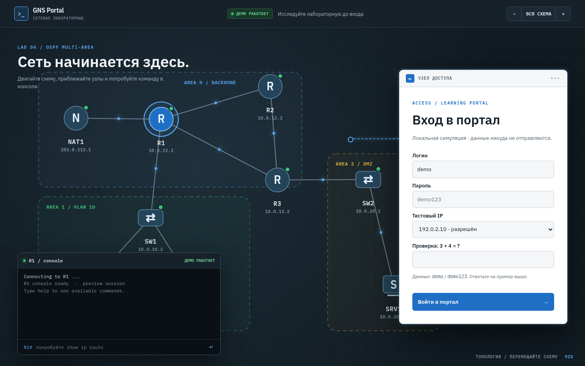

# GNS Portal — тема для Moodle 5.1

Дочерняя тема Boost, оформленная по `plugin/prototypes/student-ui.html`. Меняет общую оболочку Moodle: верхнюю навигацию, боковые панели, заголовки, курсы, карточки, списки активностей, таблицы, формы, кнопки и страницу входа. Цвета и типографика согласованы с `mod_gns3lab`. Есть светлая и тёмная схемы, мобильная компоновка и локальные шрифты IBM Plex.

На странице входа размещена интерактивная часть лабораторной: схему можно перетаскивать, масштабировать колесом, жестом или кнопками и выбирать узлы. Терминал отвечает на ограниченный набор команд (`help`, `show ip route`, `show ip interface brief`, `show ip ospf neighbor`, `show vlan brief`, `ping 10.0.20.10`). Это локальный учебный симулятор. Он не подключается к менеджеру лабораторий и не видит учётные данные Moodle. Настоящая форма входа находится в панели «Узел доступа» рядом со схемой.

## Установка в Moodle 5.1

1. Скопируйте каталог `theme/gnsportal` в `public/theme/gnsportal` дерева Moodle 5.1. Каталог плагина `plugin/plugin` по-прежнему устанавливается отдельно в `public/mod/gns3lab`.
2. Запустите штатное обновление Moodle, например `php admin/cli/upgrade.php --non-interactive` из каталога `public`.
3. Выберите **GNS Portal** в «Администрирование сайта → Внешний вид → Темы → Выбор темы».
4. Очистите кэш: `php admin/cli/purge_caches.php`.

Тема использует стандартную форму входа Moodle. Логин, пароль, токен входа, восстановление пароля, внешние провайдеры и настроенная в Moodle CAPTCHA остаются штатными. Оформление не выполняет проверку учётных данных.

## Локальная симуляция

Откройте `demo/index.html` **в корне ветки**, вне устанавливаемой темы. Схема и консоль работают до входа. Для тестового входа используйте `demo` / `demo123`, выберите IP `192.0.2.10` или `198.51.100.20` и решите пример CAPTCHA. IP `203.0.113.7` покажет сценарий запрета. Это документационные адреса; проверка живёт только в JavaScript демонстрации. Пароль не отправляется и не хранится. При настоящей установке в Moodle набор полей формы зависит от настройки сайта.

На настоящем сайте разрешённые IP задаются в обратном прокси или сетевом экране. Тема не должна решать, кому разрешён вход: код CSS и JavaScript в браузере можно обойти. Для настоящей CAPTCHA включите поддерживаемый Moodle механизм в настройках аутентификации и проверьте его на тестовом экземпляре.

## Проверка на экземпляре Moodle

- Откройте страницу входа на телефоне и на широком экране; проверьте вход, ошибочный пароль, восстановление пароля и доступные провайдеры авторизации.
- Проверьте главную страницу, «Мои курсы», курс, элемент GNS3 Lab и страницу администратора в светлой и тёмной схемах.
- Проверьте клавиатурный фокус, боковые панели и режим редактирования курса.

Автоматическая проверка в этом репозитории охватывает синтаксис PHP, SCSS и JavaScript. Здесь нет запущенного Moodle, поэтому интеграцию с его шаблонами необходимо проверить на dev-Moodle 5.1.

Шрифты IBM Plex распространяются по SIL Open Font License 1.1; текст лицензии — в `fonts/OFL.txt`.
